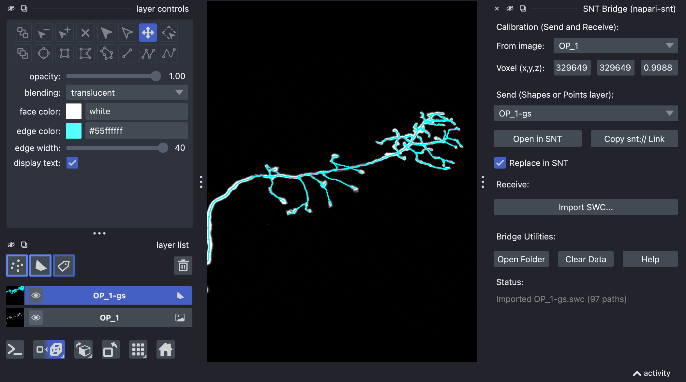

# napari-snt

[](https://github.com/morphonets/napari-snt/actions)
[](https://napari.org/stable/plugins/index.html)
[](https://github.com/copier-org/copier)

Send napari polylines to [SNT](https://github.com/morphonets/snt)
and receive SNT's SWC data as napari polylines.



------------------------------------------------------------------------------------

This [napari] plugin was generated with [copier] using the [napari-plugin-template] and was tested with [napari 0.9.2](https://github.com/napari/napari/releases/tag/v0.9.2).


## Usage

1. Make sure you are using SNT v5.0.23 or newer ([install instructions](https://imagej.net/plugins/snt/#installation))
2. Draw polylines in a Shapes layer (path or line shapes), or place ordered
   points in a Points layer.
3. Open *Plugins > SNT Bridge (napari-snt)*, pick the layer and click
   *Open in SNT* (or *Copy snt:// Link*).

The plugin writes an SWC file to `<tempdir>/snt-napari/` (one unbranched chain
per polyline, coordinates in µm, see Calibration below) and opens
`snt://open?tracings=<path>&mode=add`. SNT v5.0.23 or later must be installed in
a local Fiji. If the link cannot be opened, the SWC is still on disk and can be
opened in SNT manually.

> [!NOTE]
> macOS may use `fiji://snt/` handlers intead of `snt://`

By default, the received paths are added to those already in SNT. Tick
*Replace in SNT* to discard them instead (SNT asks for confirmation if they
are unsaved).

Layers created by *Import SWC...* carry two features per path: `id` and
`parent` (the `id` of the parent path, or -1 for roots). When such a layer is
sent, children are attached to the nearest vertex of their parent, so the
branching is preserved, even if paths are moved or vertices edited. Paths
without a valid `id` (e.g., newly drawn or pasted ones) and paths whose parent
was deleted are sent as roots, and the status line reports how many.

SWC coordinates are expected in µm. The *Calibration* section picks the image
layer to align with: if it carries a scale, that is used as voxel size.
If it is uncalibrated, enter the voxel size in the x/y/z fields, which
is applied when importing (µm to voxels) and when sending (voxels to µm).
SWC files exported by SNT state their voxel size in the header.

*Import SWC...* does the reverse: it loads SWC files (e.g., exported from SNT)
as a Shapes layer with one path per unbranched segment, in (z, y, x) order, so
that they can be sent back to SNT.

> [!TIP]
> In napari's 2D view, a 3D path is only drawn on the slices it crosses. If
> imported paths seem to be missing, check the 3D view or scroll through z.

*Open Folder* shows the bridge folder, *Clear Data* deletes the exported SWC
files in it (after confirmation), and *Help* opens this page.

## Installation

From napari: Plugins > Install/Uninstall Plugins..., scroll to the bottom of
the plugin manager window to find the manual installation text box and type:

```
git+https://github.com/morphonets/napari-snt
```

From the command line:

```bash
pip install git+https://github.com/morphonets/napari-snt
```


[napari]: https://github.com/napari/napari
[copier]: https://copier.readthedocs.io/en/stable/
[napari-plugin-template]: https://github.com/napari/napari-plugin-template
